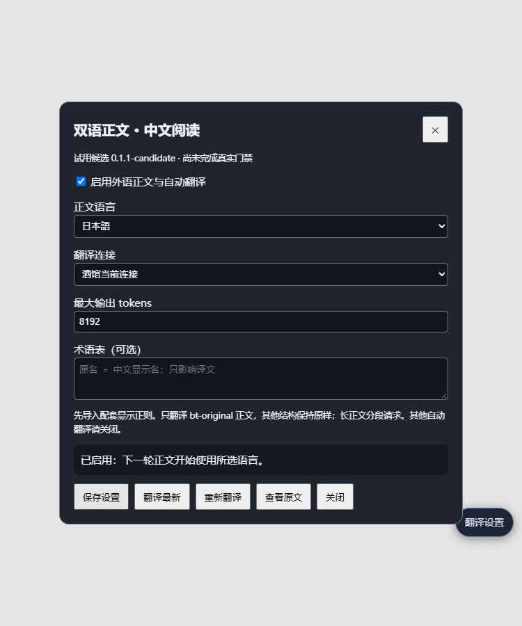

# 双语正文 · 中文阅读

酒馆助手脚本：用日文等语言生成叙事，中文仅用于阅读，原文保留在聊天记录中。附带仅作用于显示的隐藏原文正则。

**当前 0.1.1-candidate。设置入口修复候选，尚未完成真实酒馆十二回合门禁，不是已验证兼容的正式版本。**

## 下载和安装

- [下载酒馆助手脚本 JSON](https://raw.githubusercontent.com/magilittle0-byte/tavern-bilingual/main/tavern-bilingual.json)
- [下载隐藏原文正则 JSON](https://raw.githubusercontent.com/magilittle0-byte/tavern-bilingual/main/hide-original.regex.json)

若链接直接显示 JSON 文本，请保存为 `.json` 文件再导入。

1. **从旧版更新时先停用旧脚本，只启用新版。**不需要卸载酒馆助手或改动数据库。
2. 酒馆 → 扩展 → 正则 → 导入 `hide-original.regex.json`，作为全局正则启用，放在其他正文显示正则前面。保持“AI 输出 / 仅格式显示”，不要改成影响提示词。
3. 酒馆助手 → 脚本库 → 导入 `tavern-bilingual.json` 并启用。**这是助手脚本，不是在“安装扩展”里填写仓库地址的独立扩展。**
4. 首次未配置时自动打开设置页。也可点击右侧的 **翻译设置**，或打开酒馆扩展设置区的 **双语正文 · 中文阅读 → 打开双语正文设置**。
5. 选择正文语言、翻译连接，勾选启用并保存。从下一轮普通生成开始生效。

0.1.1 保留原助手脚本按钮，同时新增独立入口；即使助手的 QR 按钮没有显示，也有设置入口。宿主重新挂载入口所在元素后，脚本会恢复自己的入口；停用脚本会清理自己的界面。



## 翻译连接

- **当前酒馆连接**：复用 Chat Completion 连接及模型，额外发起翻译请求，不拼接角色卡、世界书或聊天历史。主连接是 Text Completion 时请选择保存的连接配置。
- **已保存连接配置**：选择酒馆连接管理器中的配置，可为翻译使用单独模型；不切换正文连接。
- **独立 OpenAI 兼容 API**：设置基础地址（如 `https://服务域名/v1`）、模型和 Key。Key 仅保存在本次会话内存，重载后重填；需要长期保存时使用酒馆连接管理器。

支持日文、英文、法文、韩文正文，译为简体中文；可填写术语表，手动查看原文或重译。先保存设置，再进行手动翻译。超过 3500 字符的正文分段请求，多个正文块也分别请求。失败不自动重试。

换语言可能改变表达倾向，但不能保证消除八股。翻译要求忠实保留节奏和事实，少润色、不续写，不套特定作者或轻小说风格。

## 正文与其他系统

模型被要求把纯叙事放入 `<bt-original>…</bt-original>`，保留原有正文外层标签。配套正则只隐藏这些标记内的原文；译文写入宿主显示字段 `extra.display_text`，不会替换 `mes` 原始消息。

- 不写数据库表、MVU 变量、Doctor 状态或 swipes。
- 翻译不走正文生成流程，不发通用生成/停止事件；独立请求只取消自己的 AbortController。
- 数据指令、代码、状态栏、选项与思考区保持原样，不送去翻译。正文标记混入已识别的结构时拒绝翻译。
- 编辑、切换聊天或回复、开始下一轮时，过期请求不能写入新的正文显示。
- 其他插件已经占用 `display_text` 时拒绝覆盖。请关闭其他自动翻译。
- 模型漏掉标记时不猜测正文范围，原文可能仍显示。强制中文的预设、会删除标记的正则、HTML 内生成的叙事需要实际适配。
- 原文仍会被数据库读取，但外语语义理解、实体名称一致性和联动正确性需要真实联测，当前未验收。

停用时先在设置页关闭功能并保存，再停用配套正则和脚本。只停用脚本而保留隐藏正则，带标记原文仍会被隐藏。

## 检查

0.1.1 完成 43 项合成本地检查，覆盖正文/数据块分离、异步串楼防护、接口路由、手机布局，以及隐藏脚本 iframe 下的首次自动打开、实际点击入口、入口晚加载、恢复和卸载。见 [检查报告](local-check-report.json)。这些不是实际模型、数据库/MVU/Doctor 组合的验收。

本仓库只包含脚本源码、构建文件、导入文件与合成检查材料，没有私人聊天、角色卡、世界书或凭据。

```sh
npm install
npm run build
npm test
```

检查默认使用已安装的 Microsoft Edge；可用 `PLAYWRIGHT_CHANNEL` 改为其他 Playwright 浏览器通道。

接口参考：[SillyTavern 翻译机制](https://docs.sillytavern.app/extensions/translation/)、[酒馆助手脚本按钮挂载](https://github.com/N0VI028/JS-Slash-Runner/blob/main/src/panel/script/use_button_destination_element.ts)。
